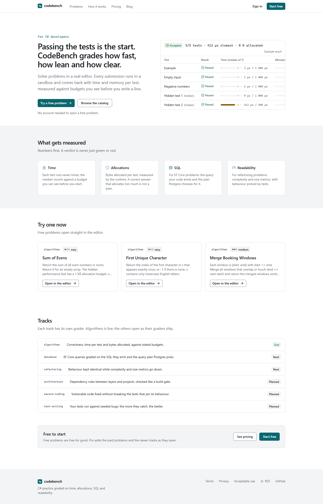
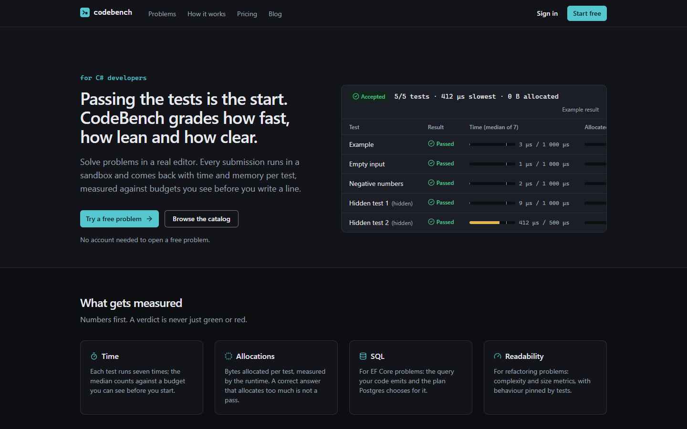
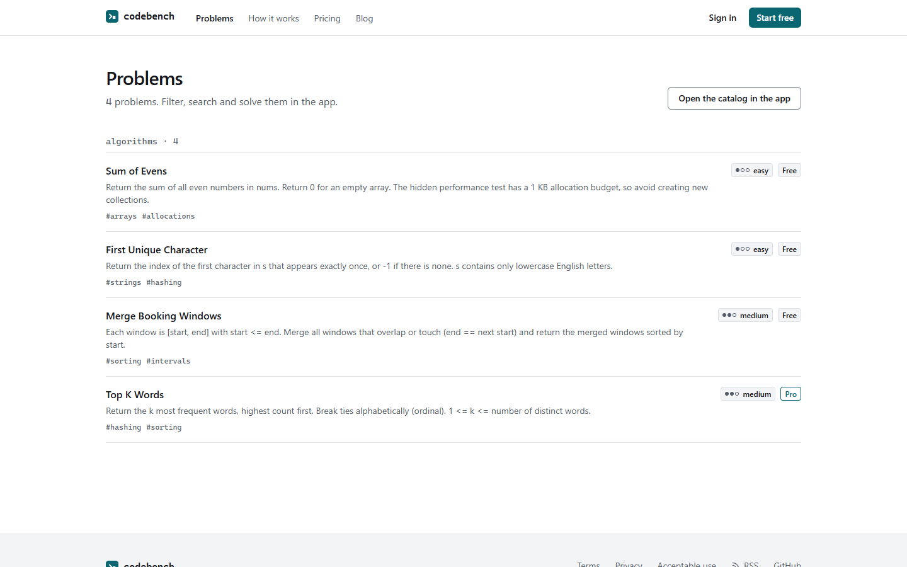
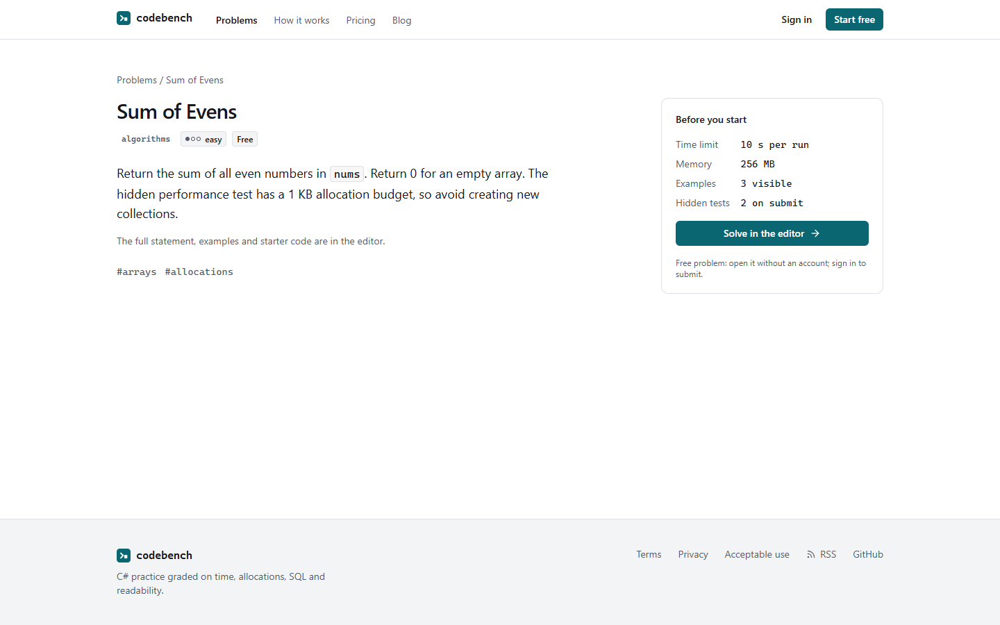
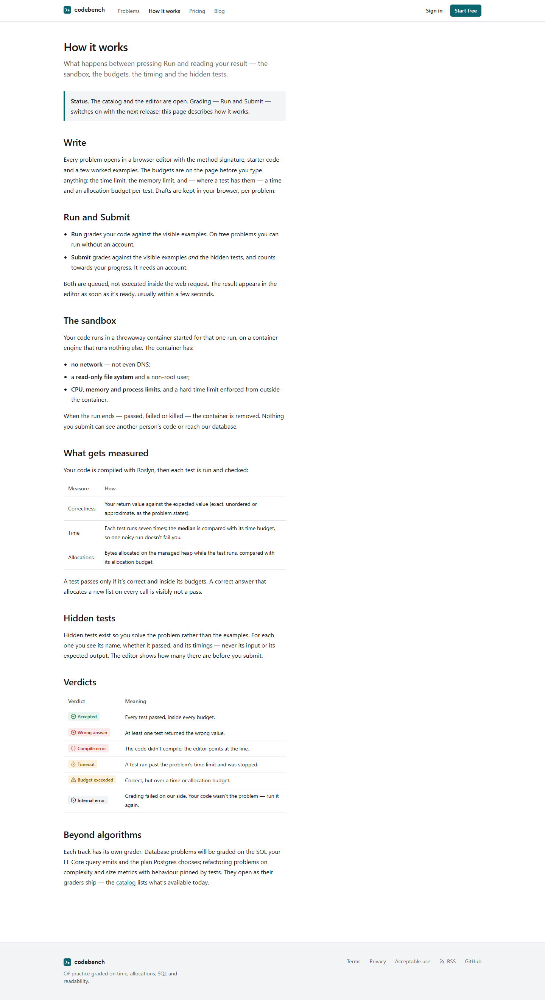
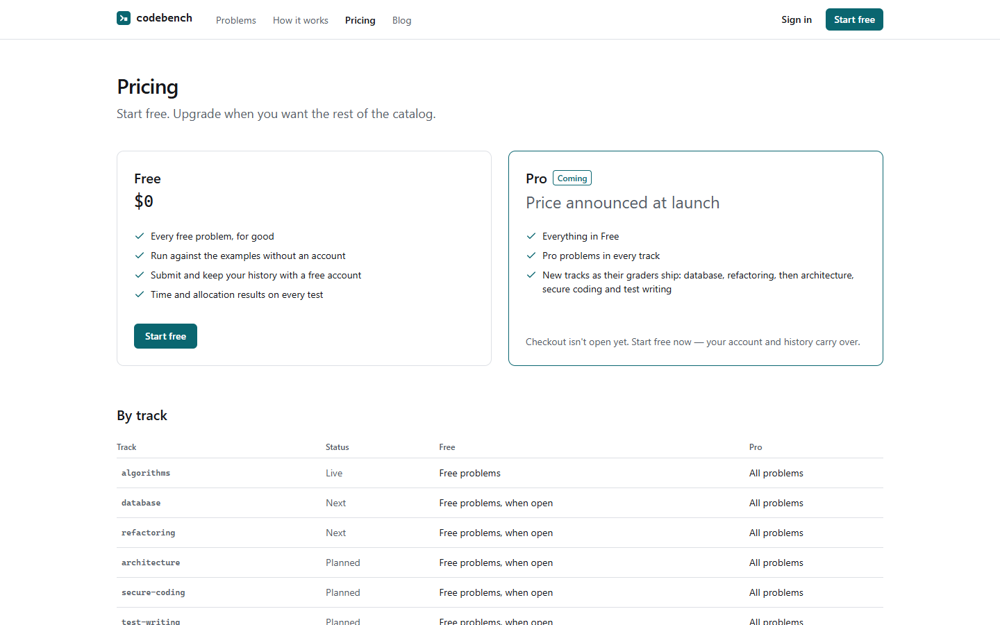
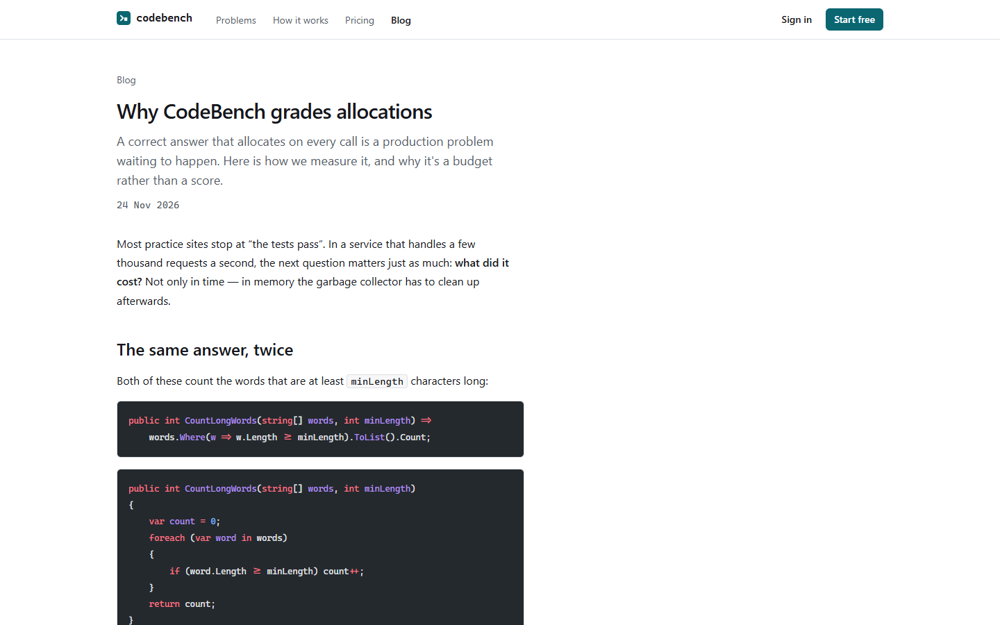
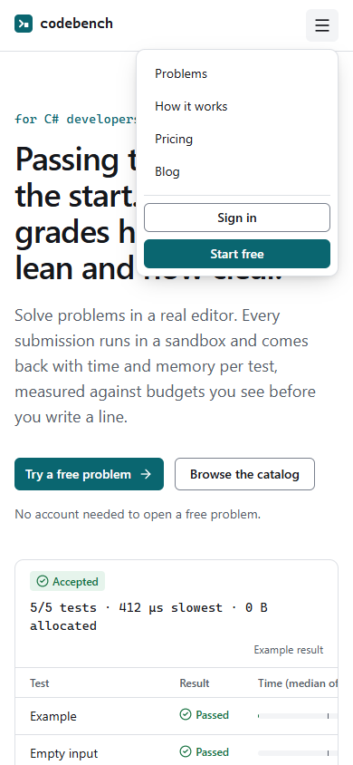

# apps/marketing — Astro static site (`codebench.localhost`)

Build plan 1.9 · [docs/guide/04-frontend.md](../../docs/guide/04-frontend.md) "Marketing site" · ADR 0007 · rule FE-13.

```bash
npm ci
npm run dev        # http://localhost:4321 — regenerates the problem catalog first
npm run check      # astro check (types + .astro diagnostics)
npm run build      # gen-problems → astro build → verify-dist
```

Links into the app use `PUBLIC_APP_URL` (default `http://app.codebench.localhost`; for `npm run dev` against the
Vite app put `PUBLIC_APP_URL=http://localhost:5173` in `apps/marketing/.env`, git-ignored).

## How it fits together

- **Static, no client framework.** `output: 'static'`; the build ships HTML + one CSS file and **no JavaScript**
  apart from a short inline script that applies `prefers-color-scheme` before first paint. No React islands —
  shadcn/ui, zustand and lucide-react stay in `apps/web` (ADR 0007).
- **Same design as the app.** `src/styles/global.css` imports `../../../../docs/design/tokens.css` (never a copy).
  `src/components/{Button,Badge,DifficultyBadge,TrackBadge,VerdictBadge,BudgetBar,Wordmark}.astro` mirror the
  app's components class for class; icons are the same Lucide set inlined from `lucide-static` (`Icon.astro`).
- **Catalog = seed summaries.** `scripts/gen-problems.mjs` turns `../../problems/*/problem.yaml` into
  `src/content/problems/*.md` (git-ignored) using an **allow-list** of public fields: title, track, difficulty,
  free, tags, limits, the statement's first paragraph, test counts. Only problems whose grader is live
  (`LIVE_GRADERS`, mirrors `ProblemSeeder.ImplementedGraders`) are published, so no link points at a problem the
  app can't open. Problems created later in the admin console appear here once exported to YAML (ADR 0005).
- **Leak guard.** `scripts/verify-dist.mjs` runs after every build and fails it if any reference-solution line,
  hidden-test value, seed SQL or source map is found in `dist/` (local version of REA check RA-06).
- **Deep links** carry `?entry=<page-slot>` (`home-hero`, `home-try-1`, `problem-page`, `site-header`, …) via
  `appLink()` in `src/config.ts` — the only file that reads `import.meta.env`.

## Screenshots

All captures live in [docs/images/screenshots/](../../docs/images/screenshots/) (naming and how to retake them:
its README).

**Home** — hero, an example result with budget bars, what gets measured, tracks, pricing teaser.

| Light (full page) | Dark |
| --- | --- |
|  |  |

**Catalog and problem pages** — generated from `problems/*.yaml`, summaries only; deep links into the app carry
`?entry=`.

| `/problems` | `/problems/sum-of-evens` |
| --- | --- |
|  |  |

**Content pages**

| How it works (full page) | Pricing | Blog post |
| --- | --- | --- |
|  |  |  |

**Mobile** — the nav collapses into a native `<details>` menu (no JavaScript):



## Docker

Build context is this folder; `docs/design` and `problems` come in as additional build contexts
(`deploy/docker-compose.yml`, `images.yml`). The final nginx image contains `dist/` only.

```bash
docker compose -f deploy/docker-compose.yml --env-file deploy/.env --profile app build marketing
```
