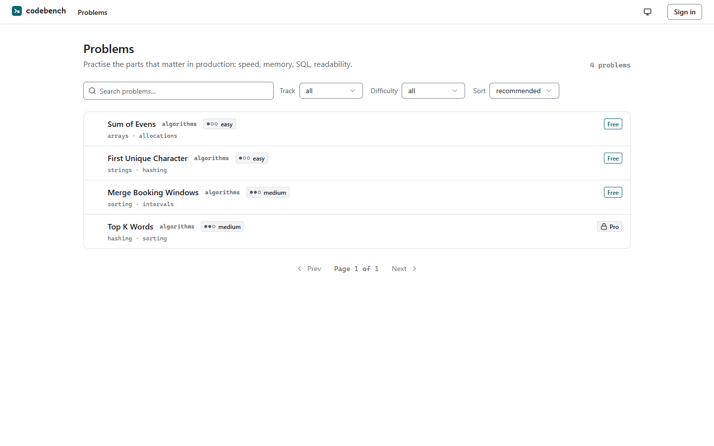
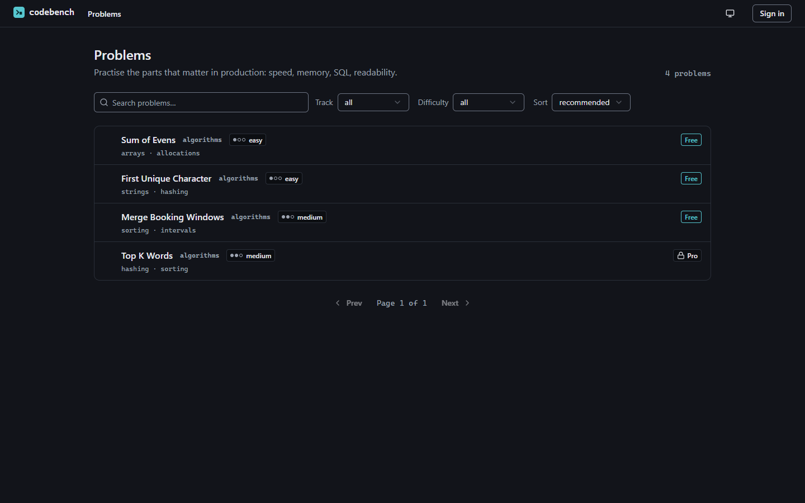
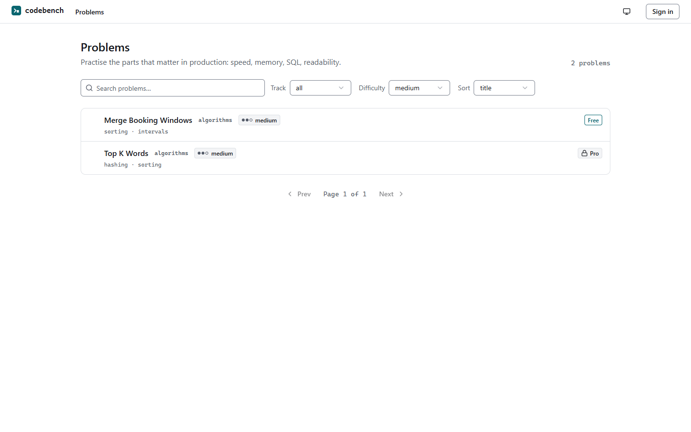
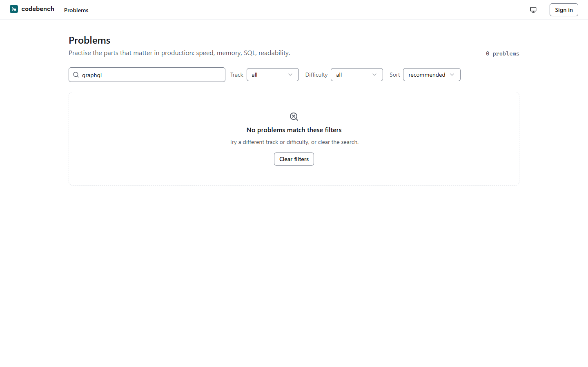
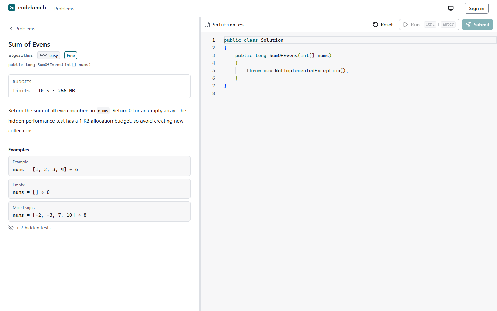
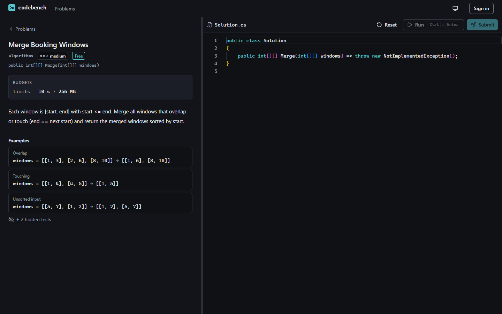
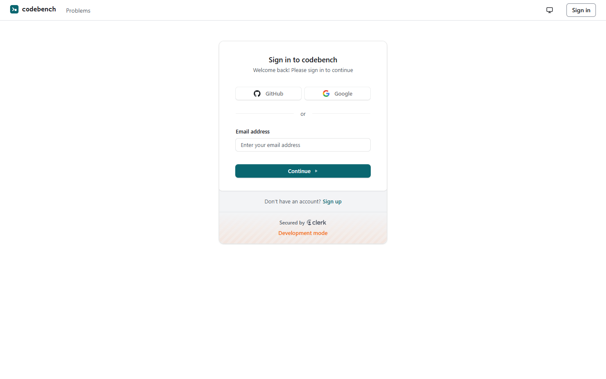
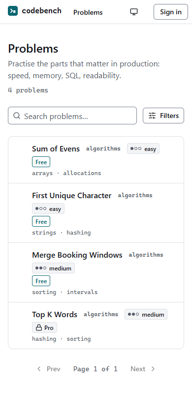
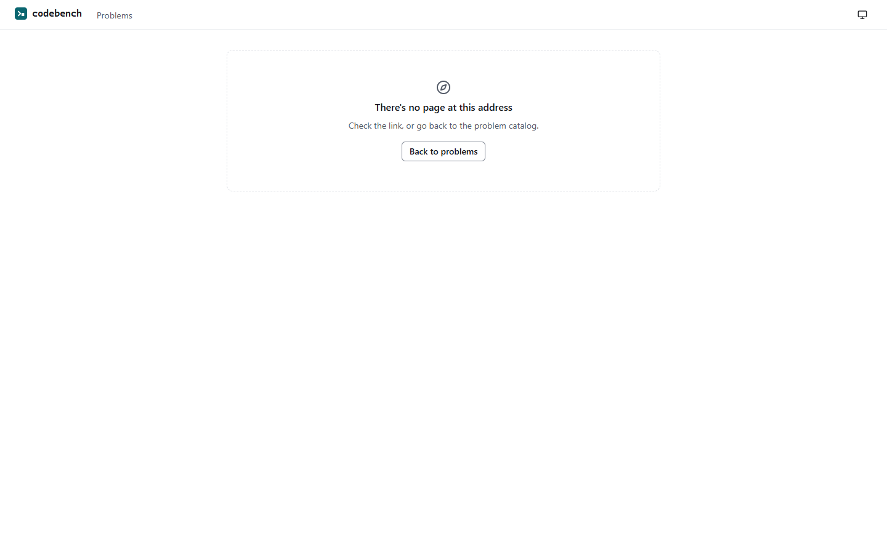

# apps/web — CodeBench app (`app.codebench.localhost`)

React 19 + Vite + TypeScript (strict), Tailwind v4 with `docs/design/tokens.css`, shadcn/ui (re-skinned),
lucide-react, zod, TanStack Query, zustand, Clerk. Guide: [docs/guide/04-frontend.md](../../docs/guide/04-frontend.md);
design contract: [docs/design/](../../docs/design/); rules FE-01…FE-17 in `context/code_rules.md`; scaffold notes
in [docs/web-notes.md](../../docs/web-notes.md).

```powershell
cp .env.example .env.local      # then set VITE_CLERK_PUBLISHABLE_KEY
npm ci
npm run dev                     # http://localhost:5173 (API on http://localhost:5000)
npm run lint; npm run typecheck; npm test -- --run; npm run build
```

| Path | What |
| --- | --- |
| `src/config.ts` | Runtime `window.__CONFIG__` (from `/config.js`) with `VITE_*` fallback — the only reader of `import.meta.env` |
| `src/lib/api.ts` | `useApi()` — the only `fetch`; Clerk JWT per request, zod parse, `ApiError` from ProblemDetails |
| `src/lib/auth.ts` | `useSession()` — thin wrapper over Clerk's `useAuth` (mocked in tests) |
| `src/components/ui/` | shadcn/ui primitives (KD-07), re-skinned to `components.md` |
| `src/components/` | Shared components: Button, Badge, DifficultyBadge, TrackBadge, VerdictBadge, BudgetBar, … |
| `src/stores/` | zustand UI state only: theme, drafts, editor layout |
| `src/features/` | `problems` (catalog), `editor` (lazy, Monaco bundled locally), `account` (`/me`, sign-in/up) |
| `Dockerfile`, `nginx.conf`, `docker/40-config.sh` | nginx image; `config.js` written at start (publishable key only) |

Docker: `docker compose -f deploy/docker-compose.yml --env-file deploy/.env --profile app up -d --build web`
(the compose file passes `docs/design` as the `design` build context).

## Screenshots

All captures live in [docs/images/screenshots/](../../docs/images/screenshots/) (naming and how to retake them:
its README).

**Catalog** — search, track / difficulty / sort filters kept in the URL, Free and Pro badges.

| Light | Dark |
| --- | --- |
|  |  |

| Filtered (`?difficulty=medium&sort=title`) | No matches — empty state |
| --- | --- |
|  |  |

**Editor** — statement, budgets up front, visible examples with the hidden-test count, Monaco with the CodeBench
theme; drafts are saved per problem. Run and Submit switch on with grading in Phase 2.

| Light | Dark |
| --- | --- |
|  |  |

**Sign-in, mobile and errors**

| Clerk sign-in, themed with our tokens | Catalog on a phone (390 px) | 404 |
| --- | --- | --- |
|  |  |  |
